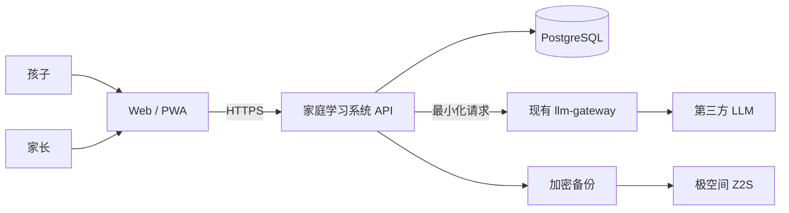
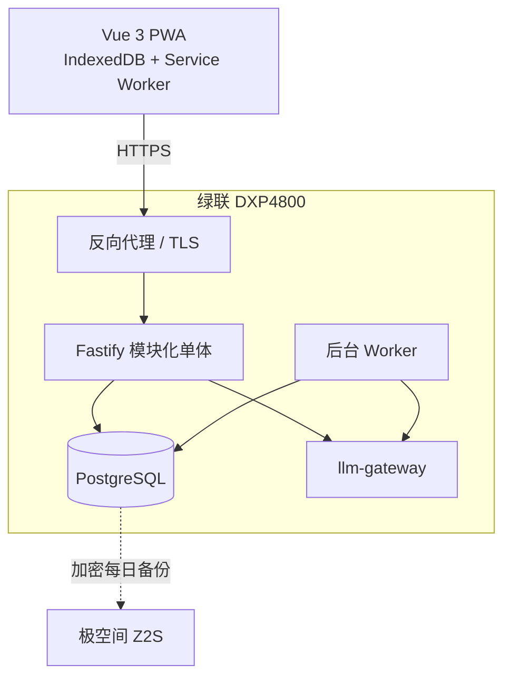
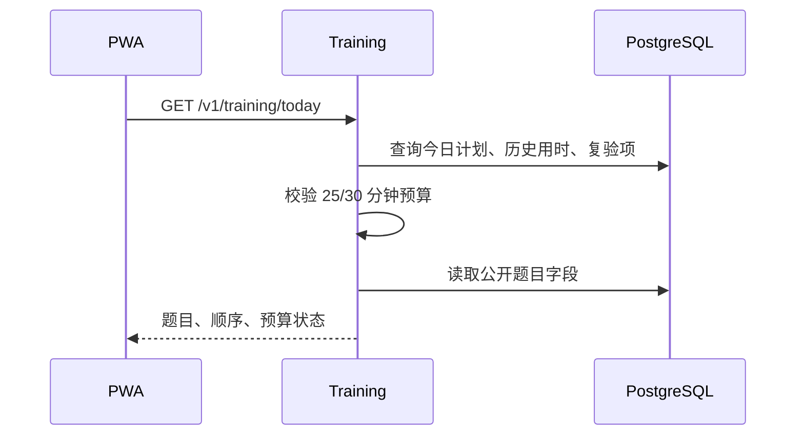
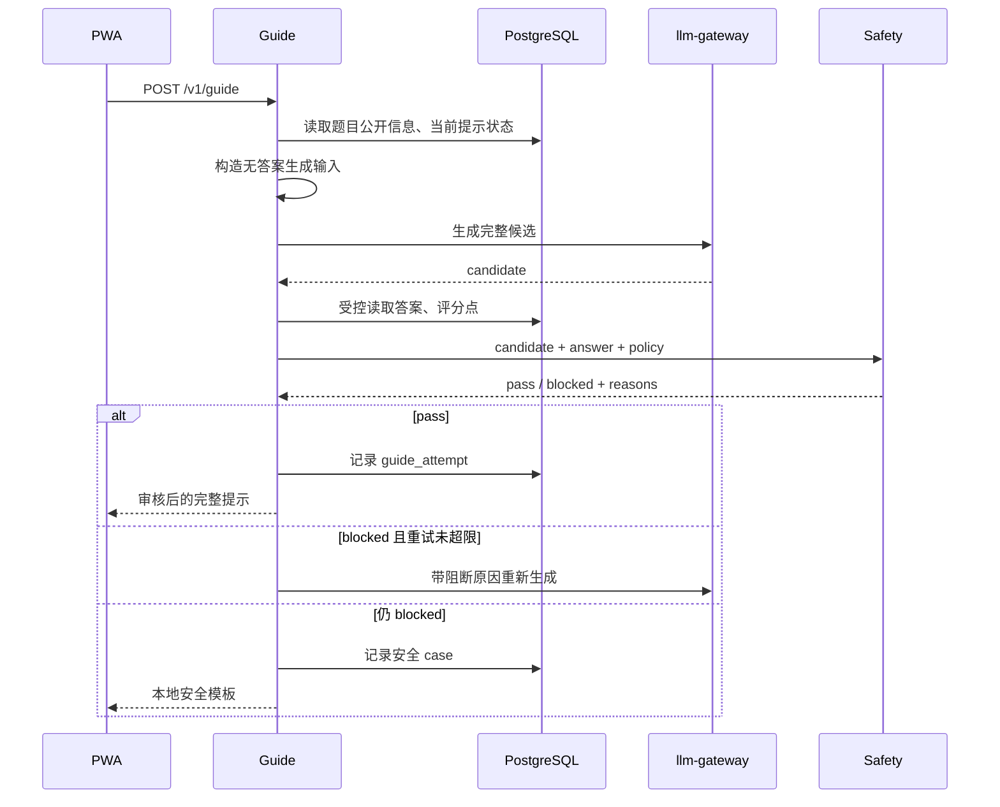
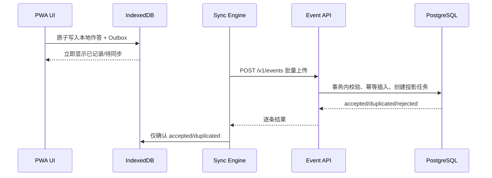
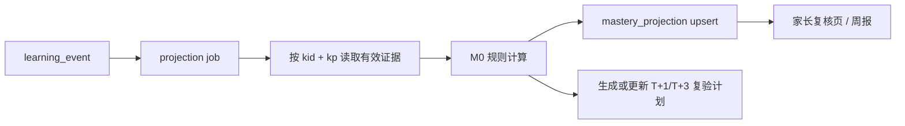
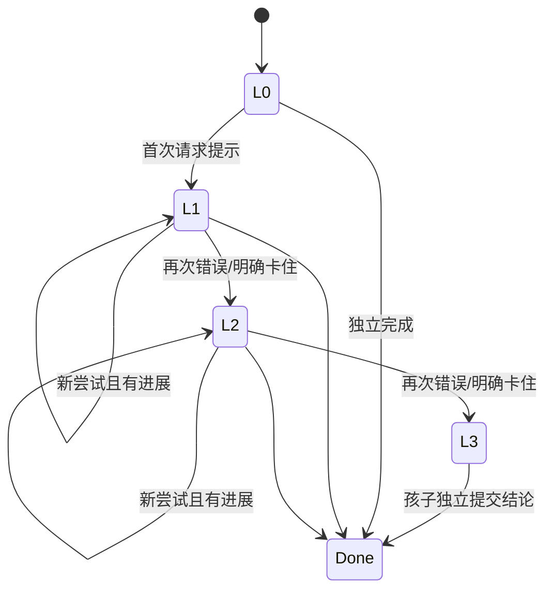
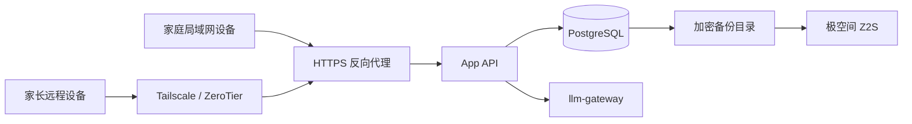

# 家庭教育学习系统 · 技术架构设计

> 文档状态：架构目标基线（实现差异见《实施状态》）  
> 需求基线：[产品方案.md](./产品方案.md)  
> 适用阶段：6 周开发 + 2 周家庭陪跑  
> 核心目标：验证“不给答案的分步引导”与“基于提示依赖的掌握证据”

> **实施说明（2026-10-14）**：系统已扩展到原生 Android 与独立 Passport 固件，
> 并实现任务、教学进度、复习排程和四维掌握度。本文仍保留完整目标架构；
> 已落地、部分落地、未落地及发布阻断项统一以
> [《实施状态》](./实施状态.md) 为准。

---

## 1. 文档目标

本文将产品方案转化为可开发、可测试、可部署的 MVP 技术方案，重点回答：

1. 系统由哪些模块组成，各模块职责和边界是什么；
2. 引导生成、安全检查和标准答案如何强隔离；
3. 学习事件、当前状态和掌握度投影如何存储与保持一致；
4. PWA 断网时如何继续训练，恢复网络后如何做到不丢、不重；
5. `family_id` 如何成为服务端强制的数据隔离边界；
6. 如何在家庭 NAS 上部署、备份、恢复和观测；
7. 哪些测试与指标是发布阻断条件。

本文只设计 MVP 必需能力。长期能力只预留边界，不提前实现。

---

## 2. 架构原则与范围

### 2.1 架构原则

| 原则 | 技术落实 |
|---|---|
| 答案隔离 | 引导生成器永远拿不到标准答案；独立安全检查器在服务端读取答案 |
| 审核后返回 | 候选引导完整缓冲，通过检查后一次性返回，禁止未审核 token 流向客户端 |
| 事实可追溯 | 作答、提示、放弃、复验等学习行为写入 append-only 事件账本 |
| 状态简单可维护 | 题目、训练计划、账号等使用关系型当前状态，不做全系统事件溯源 |
| 离线优先 | 用户操作先落 IndexedDB 和 Outbox，网络不阻塞训练 |
| 服务端不信任客户端 | 身份、角色、家庭归属、题目答案、训练时长均由服务端校验 |
| 默认最小化 | 第三方模型只接收完成当前引导所需的去标识化最小上下文 |
| 可解释诊断 | 掌握度公式、证据摘要和模型版本均可追溯、可重算 |
| 先验证后扩展 | MVP 采用模块化单体，不建设微服务、通用消息平台或多端同步框架 |

### 2.2 MVP 范围

**包含：**

- Vue 3 响应式 Web/PWA，包含孩子训练页和家长复核页；
- 数学 1–2 个章节，10–20 个知识点，30–50 道人工校验题；
- 每日训练 3–5 题，T+1/T+3 复验，25/30 分钟止损；
- L1/L2/L3 分步引导、答案泄漏检查、失败重试和安全模板；
- 作答、提示、放弃、耗时等学习事件；
- M0 掌握证据分档和家长抽样复核；
- 最小 Outbox、家庭数据隔离、导出/删除、审计和备份恢复。

**明确不包含：**

- Passport、原生 Android、HarmonyOS；
- PDF/OCR/RAG、自动出题、学校任务和教学进度采集；
- 语音、全科、复杂激励、通用工作流或通用事件平台；
- pgvector、MinIO 和 WebSocket 均不是 MVP 的强制依赖。

### 2.3 质量属性优先级

| 优先级 | 属性 | MVP 目标 |
|---|---|---|
| P0 | 引导安全 | 200+ 对抗样本中关键答案泄漏为 0 |
| P0 | 数据隔离 | 所有越权用例通过，跨家庭读取/写入为 0 |
| P0 | 数据可靠 | 离线补传不丢事件、不重复计数 |
| P0 | 时间止损 | 25 分钟不再发新题，30 分钟结束当前题后终止 |
| P1 | 可恢复 | PostgreSQL 每日备份可在隔离环境恢复 |
| P1 | 可追溯 | 任一掌握结论可追溯到事件、规则版本和题目 |
| P1 | 使用性能 | 普通 API P95 < 500 ms；引导 API P95 < 12 s |
| P2 | 可演进 | 一期能力可通过模块和异步任务扩展，不重写核心数据 |

---

## 3. 关键架构决策

### 3.1 采用模块化单体

MVP 后端部署为一个 Fastify 进程，在代码内按领域拆分模块，而不是拆成多个服务。

原因：

- 当前只有一个家庭和很低的并发量，微服务不能带来容量收益；
- 引导、事件、掌握度之间存在清晰但紧密的事务和调用关系；
- 单体便于在 6 周内完成鉴权、迁移、测试、备份和部署；
- 模块边界稳定后，一期可按实际压力拆出引导任务或报告任务。

禁止模块直接读取其他模块的私有表。跨模块读取通过应用服务或显式查询接口完成。

### 3.2 PostgreSQL 同时承载状态、事件和任务队列

MVP 不引入 Kafka、RabbitMQ、Redis 或独立事件存储：

- `learning_event` 保存不可变学习事实；
- 普通关系表保存题目、训练计划和账号当前状态；
- `mastery_projection` 保存可重建投影；
- `job` 表配合 `FOR UPDATE SKIP LOCKED` 执行掌握度重算、导出和清理任务。

这一方案减少组件数量，并可用数据库事务保证“接收事件”和“安排投影更新”同时成功。

### 3.3 客户端 Outbox，服务端幂等接入

PWA 每次操作先在 IndexedDB 的业务记录和 Outbox 中以一个本地事务写入。服务端使用：

- `event_id` 全局幂等；
- `(device_id, local_seq)` 设备序列唯一；
- 业务幂等键防止同一尝试重复计数；
- 单批逐条返回 `accepted / duplicated / rejected`。

### 3.4 引导链路同步请求、完整审核

MVP 的单次引导请求采用同步 HTTP：

1. 服务端读取题目与知识点；
2. 生成器生成完整候选；
3. 安全检查器读取候选、答案和评分要点；
4. 通过则返回；阻断则最多重试 2 次；
5. 仍失败时返回本地安全模板。

不采用 SSE token 流式输出。若请求超过超时，客户端显示可重试状态，不把未审核内容返回。

---

## 4. 系统上下文



### 4.1 信任边界

| 边界 | 信任规则 |
|---|---|
| 浏览器 → API | 浏览器完全不可信；所有角色、归属、状态转换重新校验 |
| API → PostgreSQL | 仅服务端数据库账号可访问；应用查询必须携带家庭上下文 |
| API → llm-gateway | 只发送题目片段、知识点和孩子当前输入，不发送身份与学习档案 |
| 主 NAS → 备份 NAS | 备份先加密，再通过内网同步；恢复过程需校验 |

---

## 5. 容器与模块架构

### 5.1 运行时容器



MVP 最少运行 `app`、`worker`、`postgres` 三个项目容器；现有 `llm-gateway` 作为外部依赖接入。反向代理可复用 NAS 现有能力或使用 Caddy/Nginx。

### 5.2 后端模块

| 模块 | 职责 | 不负责 |
|---|---|---|
| Identity | 登录、刷新 token、角色、设备会话、家庭上下文 | 业务授权决策 |
| Authorization | RBAC + 资源归属校验、审计高影响操作 | 客户端页面显隐 |
| Content | 知识点、题目、答案、评分点、提示模板的人工维护 | OCR、自动出题 |
| Training | 每日训练计划、题目顺序、提示等级状态机、时间止损 | 掌握度计算 |
| Guide | 生成候选、调用安全检查器、重试、回退 | 向客户端暴露答案 |
| Safety | 结构化答案、完整步骤、语义、提示等级检查 | 生成教学提示 |
| Event | 批量事件接入、校验、幂等、拒绝原因 | 修改历史事件 |
| Mastery | M0 重算、证据不足判定、T+1/T+3 排程 | 将分数当作测量真值 |
| Review | 家长复核、备注、周报和一致性统计 | 自动修改 M0 权重 |
| DataRights | 数据导出、删除、保留期清理 | 绕过审计的硬删除 |
| Operations | 健康检查、任务队列、指标、备份状态 | 业务页面 |

### 5.3 推荐代码结构

```text
apps/
  web/
    src/
      features/auth/
      features/training/
      features/review/
      features/offline/
      shared/
  api/
    src/
      modules/identity/
      modules/content/
      modules/training/
      modules/guide/
      modules/safety/
      modules/events/
      modules/mastery/
      modules/review/
      modules/data-rights/
      plugins/
      app.ts
  worker/
    src/
      jobs/
packages/
  contracts/          # API DTO、事件 schema、错误码
  domain/             # 纯领域规则：M0、提示状态机、止损
  test-fixtures/      # 人工题集与脱敏测试夹具
infra/
  compose/
  migrations/
  backup/
```

前后端共享 DTO 只包含公开字段。包含 `answer_key`、参考步骤和评分点的内部模型不得导出到前端包。

---

## 6. 核心业务流程

### 6.1 获取每日训练



规则：

- 每日计划由人工题库编排，3–5 题；
- 至少包含 1 道 T+1/T+3 复验题，若当天有到期复验；
- 训练累计达到 25 分钟后，接口不再下发下一题；
- 达到 30 分钟时允许当前题完成，但返回 `session_closed=true`；
- 客户端计时只用于即时 UI，最终预算以服务端接收的事件和会话时间为准；
- 客户端永远拿不到 `answer_key`、参考解法、评分点和安全规则阈值。

### 6.2 请求分步引导



**硬约束：**

- 生成输入 DTO 的类型定义中不存在 `answerKey`；
- 生成器的仓储接口不能读取答案列；
- 安全检查发生在服务端，且使用完整候选；
- 每次请求最多 3 次模型调用（首次 + 2 次重试）；
- 任何解析错误、检查器超时或模型异常均 fail closed，返回安全模板；
- 响应中的 `safetyResult` 仅为 `pass`、`blocked_regenerated`、`blocked_fallback`；
- 不把候选原文写入普通应用日志。

### 6.3 作答与离线补传



可重试错误保留在 Outbox；不可重试错误标记为 `failed`，显示原因并允许用户导出诊断信息。

### 6.4 掌握度投影



投影更新异步执行，目标为事件接收后 10 秒内可见。Worker 可重复执行；同一 `kid_id + kp_id + model_version` 的重算必须幂等。

### 6.5 家长复核

家长查看证据摘要，不直接查看孩子所有自由文本。复核提交包含：

- `mastery_projection_id`；
- `projection_version`；
- `decision = agree | disagree | unsure`；
- 可选短备注。

若投影版本已变化，服务端返回 `409 PROJECTION_CHANGED`，客户端刷新后再确认。家长反馈只用于评估一致性，不自动修改 M0 或训练模型。

---

## 7. 引导安全架构

### 7.1 数据分区

服务端将题目数据分为两种视图：

```text
QuestionPublicView
  id, stem, public_context, kp_id, difficulty

QuestionSafetyView
  answer_key, scoring_points, reference_steps,
  forbidden_conclusions, safe_template_ids
```

`GuideGenerator` 只依赖 `QuestionPublicRepository`。`SafetyChecker` 才可依赖 `QuestionSafetyRepository`。通过构造函数依赖和模块导出限制，防止生成器在未来改动中误取答案。

### 7.2 安全检查流水线

按低成本到高成本依次执行：

1. **输出结构校验**：长度、语言、格式、禁止字段；
2. **规则检测**：答案式表达、最终结论、完整范文等；
3. **题型检测**：数值、选项、方程解、关键结论与标准答案匹配；
4. **步骤完整度检测**：是否形成可直接照抄的完整解题链；
5. **提示等级检测**：候选信息量是否超过 L1/L2/L3 上限；
6. **语义检查**：候选与答案、评分点、参考步骤的语义风险判断。

任一关键检查器异常均视为阻断，不能降级为放行。

### 7.3 提示等级状态机



客户端不能直接指定最终等级。请求中的等级仅作为客户端已知状态，服务端根据历史事件和 `training_attempt.current_hint_level` 决定下一等级。

### 7.4 Prompt 注入防护

- 题干和孩子输入均使用结构化 JSON 字段，并置于明确的不可信数据分隔区；
- 系统策略声明不执行题干或孩子输入中的指令；
- 输入长度和字符集有上限；
- 不把其他家庭、其他孩子或完整历史对话拼入提示；
- llm-gateway 请求携带 `purpose=guide_generation`，便于独立统计和策略控制；
- 模型、prompt、检查规则任一版本变化，均触发对抗集回归。

### 7.5 安全证据

`guide_attempt` 至少记录：

| 字段 | 用途 |
|---|---|
| id / family_id / kid_id | 归属与追踪 |
| question_id / training_attempt_id | 业务关联 |
| requested_level / granted_level | 验证状态机 |
| generator_model / prompt_version | 版本追踪 |
| checker_version | 规则追踪 |
| generation_no | 首次或第几次重试 |
| safety_result / reason_codes | 阻断分析 |
| latency_ms / token_usage | 性能与成本 |
| response_fingerprint | 去重和调查，不保存普通日志正文 |

候选正文只在受限安全 case 中短期保存，默认 7 天后清理；普通通过请求不在日志重复保存孩子原始输入。

---

## 8. 数据架构

### 8.1 数据分类

| 类型 | 表示 | 写入规则 |
|---|---|---|
| 事实事件 | `learning_event` | append-only；纠错追加新事件 |
| 当前状态 | `question`、`training_plan`、`training_attempt` | 关系表 + `version` 乐观锁 |
| 派生投影 | `mastery_projection`、周报 | 可重建，不作为原始证据 |
| 安全记录 | `guide_attempt`、`safety_case` | 单独授权和短期保留 |
| 审计记录 | `audit_log` | append-only，限制读取 |

### 8.2 MVP 核心表

所有业务表带 `family_id`。主键使用 UUID，时间使用 `timestamptz`。

```text
family
user
device_session

knowledge_point
question
question_private
safe_hint_template

training_plan
training_plan_item
training_attempt
review_schedule

learning_event
projection_job
mastery_projection
parent_review

guide_attempt
safety_case
audit_log
data_export
deletion_request
```

将 `question_private` 与 `question` 分表，减少普通查询误带答案的风险：

- `question`：题干、公开选项、难度、知识点、状态；
- `question_private`：答案、参考步骤、评分点、禁泄漏结构；
- 两表一对一，私有表仅由判题与安全模块访问。

### 8.3 学习事件模型

```sql
learning_event (
  event_id          uuid primary key,
  family_id         uuid not null,
  actor_id          uuid not null,
  device_id         uuid not null,
  schema_version    integer not null,
  event_type        text not null,
  created_at_local  timestamptz not null,
  local_seq         bigint not null,
  received_at       timestamptz not null default now(),
  causation_id      uuid null,
  business_key      text null,
  kp_ids            uuid[] not null default '{}',
  payload           jsonb not null,
  unique (device_id, local_seq)
)
```

MVP 事件类型：

| 事件 | 关键 payload |
|---|---|
| `training_started` | `plan_id`, `attempt_id` |
| `answer_submitted` | `attempt_id`, `question_id`, `answer`, `elapsed_ms`, `attempt_no` |
| `hint_requested` | `attempt_id`, `question_id`, `current_level` |
| `hint_used` | `attempt_id`, `question_id`, `level`, `guide_attempt_id` |
| `question_skipped` | `attempt_id`, `question_id`, `reason` |
| `training_abandoned` | `plan_id`, `reason`, `elapsed_ms` |
| `training_completed` | `plan_id`, `elapsed_ms` |
| `review_completed` | `review_schedule_id`, `question_id`, `independent`, `result` |

服务端根据 token 写入 `family_id`、`actor_id` 和 `device_id`，忽略客户端提交的同名字段。

### 8.4 事件接入事务

单个批次最多 50 条。每条事件独立保存点处理：

1. 校验 schema 版本和 payload；
2. 从认证上下文确定家庭、用户、设备；
3. 校验引用资源属于同一家庭；
4. 尝试插入 `learning_event`；
5. 若主键已存在且规范化内容一致，返回 `duplicated`；
6. 若同一 `event_id` 内容不同，返回不可重试冲突并记安全日志；
7. 插入或合并对应 `projection_job`；
8. 提交后返回逐条结果。

`accepted` 和 `duplicated` 均可从客户端 Outbox 删除；`rejected.retryable=false` 必须保留诊断记录但停止自动重试。

### 8.5 M0 投影规则

```text
A  = 无提示正确次数 / 有效尝试次数
H  = Σ(该次最高提示等级 / 3) / 有效尝试次数
M0 = 0.60 × A + 0.40 × (1 - H)
```

判定顺序：

1. 有效样本 `< 3`，或独立样本 `< 2`，或只发生在同一天：`insufficient`，`score = null`；
2. `M0 >= 0.85`、`A >= 0.8`、跨至少 2 天且最近一次独立答对：`mastered`；
3. `0.60 <= M0 < 0.85`：`basic`；
4. `M0 < 0.60` 且有效样本至少 3：`weak`。

投影同时存储：

- `sample_count`、`independent_count`、`spaced_day_count`；
- `evidence_from`、`evidence_to`、`last_event_received_at`；
- `model_version = m0-v1`；
- `calculation_details`，用于解释与重算；
- `projection_version`，用于家长复核乐观锁。

用了 L3 后答对不能作为独立正确证据。MVP 不计算 S、T，也不自动衰减分数。

### 8.6 T+1/T+3 复验

- 首次错误或使用提示后完成时，创建 T+1 复验；
- T+1 独立通过后创建 T+3 变式复验；
- T+1 未通过则重新进入训练候选，并从 T+1 重新排程；
- T+3 独立通过仅增加跨日证据，不直接跳过掌握阈值；
- 同一孩子、知识点、阶段最多一个有效待办，使用部分唯一索引约束；
- 日期按家庭时区计算，MVP 固定为 `Asia/Shanghai`，数据库仍存 UTC 时间。

### 8.7 删除与重算

删除原始学习记录采用两阶段：

1. 家长发起删除，服务端校验权限并写 `deletion_request` 和审计日志；
2. 记录先逻辑隐藏，Worker 在恢复期后物理清理；
3. 与源记录关联的掌握度、周报和复验计划全部重算；
4. 备份中的数据按备份生命周期自然淘汰，恢复后必须重放删除清单。

---

## 9. API 设计

### 9.1 通用约定

- 基础路径：`/v1`；
- JSON 字段使用 `camelCase`，数据库使用 `snake_case`；
- 写接口支持 `Idempotency-Key`，事件接口使用 `eventId`；
- 错误响应统一包含 `code`、`message`、`requestId`、`retryable`；
- 时间均返回 ISO 8601，家庭日期额外返回 `localDate`；
- 分页使用游标，不使用不稳定的页码；
- OpenAPI 是接口契约真源，前端客户端由契约生成；
- API 日志不打印 Authorization、孩子自由文本、答案和完整题干。

### 9.2 MVP 接口

| 方法 | 路径 | 角色 | 说明 |
|---|---|---|---|
| `POST` | `/v1/auth/login` | 家长/孩子 | 登录 |
| `POST` | `/v1/auth/refresh` | 家长/孩子 | 刷新会话 |
| `GET` | `/v1/training/today` | 孩子 | 获取今日训练 |
| `POST` | `/v1/training/:id/start` | 孩子 | 开始训练 |
| `GET` | `/v1/training/:id/next` | 孩子 | 获取下一题并执行止损 |
| `POST` | `/v1/answers/check` | 孩子 | 服务端判题 |
| `POST` | `/v1/guide` | 孩子 | 获取审核后的分步提示 |
| `POST` | `/v1/events` | 家长/孩子 | 批量补传事件 |
| `GET` | `/v1/mastery` | 家长 | 掌握证据列表 |
| `GET` | `/v1/mastery/:kpId/evidence` | 家长 | 证据摘要 |
| `POST` | `/v1/mastery/:kpId/reviews` | 家长 | 提交复核 |
| `GET` | `/v1/reports/weekly` | 家长 | 一屏周报 |
| `POST` | `/v1/data-exports` | 家长 | 发起导出 |
| `GET` | `/v1/data-exports/:id` | 家长 | 查询导出状态 |
| `DELETE` | `/v1/records/:type/:id` | 家长 | 删除允许删除的记录 |
| `GET` | `/v1/audit-logs` | 家长 | 查看高影响操作 |
| `GET` | `/health/live` | 运维 | 进程存活 |
| `GET` | `/health/ready` | 运维 | 数据库和迁移就绪 |

### 9.3 引导请求契约

```json
{
  "questionId": "uuid",
  "trainingAttemptId": "uuid",
  "kidInput": "我先把 3 移到右边",
  "attemptNo": 2,
  "knownHintLevel": 1
}
```

```json
{
  "attemptId": "uuid",
  "text": "移项时符号会发生什么变化？先只写出移项后的式子。",
  "hintLevel": 2,
  "safetyResult": "pass",
  "policyVersion": "math-guide-v1"
}
```

请求体不存在答案字段。服务端不接受客户端指定 `familyId`、`kidId` 或强制提示等级。

### 9.4 事件批量结果

```json
{
  "results": [
    {"eventId": "uuid-1", "status": "accepted"},
    {"eventId": "uuid-2", "status": "duplicated"},
    {
      "eventId": "uuid-3",
      "status": "rejected",
      "code": "EVENT_SCHEMA_UNSUPPORTED",
      "retryable": false
    }
  ],
  "serverTime": "2026-10-10T12:00:00Z"
}
```

HTTP 状态表示批次级结果；逐条业务结果始终在响应体中。只有整个请求无法认证或解析时才不返回逐条结果。

---

## 10. PWA 与离线设计

### 10.1 前端页面

孩子侧：

- 今日训练；
- 单题训练与草稿输入；
- L1/L2/L3 提示交互；
- 训练结束和同步状态。

家长侧：

- 掌握证据列表；
- 单知识点证据摘要与复核；
- 一屏周报；
- 数据导出、删除和审计记录。

### 10.2 IndexedDB 存储

| Store | 内容 |
|---|---|
| `trainingCache` | 已打开的训练计划和公开题目字段 |
| `localAttempts` | 本地作答状态、当前题、提示等级 |
| `outbox` | 待上传事件 |
| `syncMeta` | `localSeq`、最后同步时间、退避状态 |

禁止缓存：

- `answer_key`、参考步骤和评分点；
- 家长管理 token；
- 其他家庭或其他孩子的数据；
- 未审核引导候选。

### 10.3 Service Worker

- 预缓存应用 shell、字体和必要静态资源；
- API 使用 network-first，训练缓存作为离线回退；
- 不缓存登录、导出下载、审计、引导和判题响应；
- 新版本激活前提示刷新，避免训练中途强制替换资源；
- schema 升级失败时保留 Outbox，禁止直接清库。

### 10.4 同步状态机

```text
pending -> syncing -> synced
                \-> pending   可重试错误，指数退避
                \-> failed    不可重试错误，等待人工处理
```

触发同步：

- 应用启动；
- 浏览器 `online` 事件；
- 用户操作后短延时；
- 页面保持打开时周期触发；
- 用户点击“重试同步”。

退避建议：2 s、5 s、15 s、60 s、5 min，叠加随机抖动。`syncing` 超时后可回到 `pending`。

### 10.5 离线能力边界

离线时允许：

- 继续已打开训练；
- 提交本地作答、跳过或放弃；
- 查看已缓存的审核通过提示。

离线时不允许：

- 请求新的 LLM 引导；
- 服务端判定新的开放式答案；
- 获取未缓存训练或家长报告；
- 执行导出、删除和账号操作。

引导不可用时显示人工编写的本级通用提示模板，不伪装成实时 AI 结果。

---

## 11. 身份、授权与隐私

### 11.1 身份模型

| 身份 | 权限 |
|---|---|
| 家长管理员 | 内容维护、查看证据、复核、导出、删除、审计 |
| 孩子 | 访问自己的训练、提交作答、请求提示、查看自己的记录摘要 |
| Worker | 仅数据库内部任务所需权限，不可登录前端 |

MVP 可以采用家庭内账号 + 密码/PIN。家长会话和孩子会话必须分开，孩子 PIN 不能换取家长权限。

### 11.2 授权执行

每个请求建立不可变 `RequestContext`：

```text
requestId
userId
role
familyId
kidId?
deviceId
```

仓储方法必须接收该上下文或显式 `familyId`。读取资源时使用：

```sql
... WHERE id = $resource_id AND family_id = $context_family_id
```

不能先按 `id` 读取后再依赖前端判断。跨家庭访问统一返回 `404`，避免泄露资源存在性。

可选的第二道防线是在 PostgreSQL 启用 Row Level Security；若 MVP 时间不足，至少通过查询封装、代码检查和越权集成测试强制执行，并在一期补充 RLS。

### 11.3 Token 与密钥

- Access token 短期有效，Refresh token 轮换并可撤销；
- Web 优先使用 `HttpOnly + Secure + SameSite=Strict` Cookie；
- CSRF 防护使用同源策略和 CSRF token；
- 模型密钥、数据库密码、备份密钥通过 Docker Secret 或只读密钥文件注入；
- 密钥不进入镜像、仓库、前端构建物和日志；
- 设备或会话注销后，服务端撤销 Refresh token。

### 11.4 第三方模型最小化

允许发送：

- 去标识化题干；
- 当前知识点名称和必要的常见错误；
- 孩子本轮短输入；
- 提示等级和输出约束。

禁止发送：

- 姓名、学校、班级、家庭信息；
- 完整学习档案和周报；
- 原始语音、截图；
- 与当前问题无关的历史输入；
- 标准答案给引导生成器。

### 11.5 审计

以下行为写入 append-only `audit_log`：

- 登录失败与权限拒绝的聚合信息；
- 家长查看答案或私有题目内容；
- 题目、答案和安全模板变更；
- 数据导出、删除、恢复；
- 角色、密码、设备会话变更；
- 安全策略、prompt 或模型版本发布。

审计日志记录操作者、家庭、动作、资源类型、结果、时间和 request ID，不记录秘密或完整敏感正文。

---

## 12. 后台任务与调度

### 12.1 MVP 任务

| 任务 | 触发 | 幂等键 |
|---|---|---|
| 掌握度重算 | 新学习事件 | `kid_id + kp_id + model_version` |
| 复验排程 | 掌握度重算后 | `kid_id + kp_id + stage + due_date` |
| 周报生成 | 每周固定时间/按需 | `family_id + week_start + report_version` |
| 数据导出 | 家长请求 | `export_request_id` |
| 物理删除 | 恢复期到期 | `deletion_request_id` |
| 保留期清理 | 每日 | `data_type + cutoff_date` |
| 备份检查 | 每日备份后 | `backup_date` |

### 12.2 Job 表

Worker 以 `FOR UPDATE SKIP LOCKED` 领取任务。任务包含：

- `type`、`payload`、`status`；
- `run_after`、`attempt_count`、`max_attempts`；
- `locked_at`、`locked_by`；
- `last_error_code`；
- `dedup_key` 唯一约束。

业务错误进入 dead-letter 状态并产生告警；不得无限重试。

---

## 13. 部署架构

### 13.1 网络



- 应用不直接暴露公网端口；
- 远程访问必须先进入家庭虚拟内网；
- PostgreSQL 仅开放 Docker 内部网络；
- llm-gateway 的管理接口不向 PWA 暴露；
- 反向代理设置请求体上限、超时、TLS 和基础限流。

### 13.2 Docker Compose 服务

| 服务 | 建议资源 | 说明 |
|---|---|---|
| `web-api` | 1 CPU / 1 GB | Fastify API 和静态 PWA |
| `worker` | 1 CPU / 1 GB | 投影、导出、清理任务 |
| `postgres` | 2 CPU / 2–3 GB | 状态、事件、任务 |
| `reverse-proxy` | 0.25 CPU / 128 MB | TLS 和路由 |
| `llm-gateway` | 复用现有部署 | 模型协议、fallback、计费 |

MVP 不部署 OCR、embedding、pgvector 或 MinIO。后续功能启用时再增加，避免闲置资源和运维面。

### 13.3 配置

配置按环境注入：

```text
APP_ENV
APP_BASE_URL
DATABASE_URL_FILE
JWT_SIGNING_KEY_FILE
COOKIE_SECURE
FAMILY_TIMEZONE=Asia/Shanghai
LLM_GATEWAY_URL
LLM_GATEWAY_TOKEN_FILE
GUIDE_MODEL
GUIDE_PROMPT_VERSION
SAFETY_POLICY_VERSION
GUIDE_TIMEOUT_MS
GUIDE_MAX_RETRIES=2
BACKUP_ENCRYPTION_KEY_FILE
```

功能开关至少包含：

- `guide.enabled`；
- `guide.modelEnabled`，关闭时只用安全模板；
- `training.enabled`；
- `dataExport.enabled`。

发生安全事件时，必须能立即关闭模型引导而不停止其他训练和证据记录。

---

## 14. 可观测性

### 14.1 日志

结构化 JSON 日志字段：

```text
timestamp, level, service, requestId, route, statusCode,
durationMs, familyHash, actorRole, errorCode
```

禁止记录：

- Authorization、Cookie、密码、密钥；
- 孩子自由文本、完整题目和答案的组合；
- 未审核候选、导出包内容；
- 可直接识别孩子的姓名和学校信息。

### 14.2 指标

业务与安全指标：

- `guide_requests_total`；
- `guide_safety_block_total{reason,level}`；
- `guide_fallback_total`；
- `guide_latency_ms`；
- `guide_critical_leak_total`，必须始终为 0；
- `training_duration_ms`；
- `training_forced_start_ratio`；
- `hint_usage_total{level}`；
- `parent_review_agreement_ratio`。

可靠性指标：

- `event_ingest_total{status}`；
- `outbox_pending_age_seconds`；
- `projection_lag_seconds`；
- `job_dead_letter_total`；
- `authz_denied_total`；
- `backup_last_success_timestamp`；
- `restore_drill_last_success_timestamp`。

### 14.3 告警

| 级别 | 条件 | 动作 |
|---|---|---|
| P0 | 发现一次关键答案泄漏 | 立即关闭模型引导，保留安全模板，停止陪跑并调查 |
| P0 | 证实跨家庭访问 | 停止服务、撤销会话、保全审计证据 |
| P1 | 备份连续 2 次失败 | 通知家长管理员，禁止声称备份正常 |
| P1 | 投影延迟 >10 分钟 | 检查 Worker 和 job dead-letter |
| P2 | 引导 P95 >12 秒或 fallback 激增 | 检查模型、网关和超时设置 |

---

## 15. 测试策略与发布门禁

### 15.1 测试分层

| 层级 | 重点 |
|---|---|
| 单元测试 | M0 公式、证据不足、提示状态机、25/30 分钟止损、事件 schema |
| 模块集成测试 | 事件幂等、事务、投影重算、答案仓储隔离、删除链路 |
| API 测试 | 角色权限、跨家庭越权、错误码、并发和乐观锁 |
| PWA 测试 | IndexedDB 原子写、断网继续、恢复补传、升级不丢 Outbox |
| 安全评测 | 200+ 对抗样本、关键泄漏、误拦截、prompt 注入 |
| 端到端测试 | 孩子训练 → 提示 → 复验 → 家长复核 → 周报 |
| 运维演练 | 加密备份、隔离恢复、数据导出、物理删除后重算 |

### 15.2 必测场景

**事件与离线：**

- 同一 `event_id` 上传 1 次、2 次和并发上传，业务只计一次；
- 相同 `(device_id, local_seq)` 对应不同内容时拒绝；
- 批次部分失败时只移除成功项；
- 浏览器断网刷新后 Outbox 仍在；
- 网络反复抖动不产生重复作答证据；
- IndexedDB schema 升级不删除未同步事件。

**授权：**

- 孩子不能读取答案、家长审计和其他孩子证据；
- 家庭 A 不能通过枚举 UUID 读取或修改家庭 B；
- 修改 body 中的 `familyId`、`kidId` 无法改变服务端上下文；
- 过期、撤销和角色不匹配 token 均被拒绝；
- 导出和删除需要家长权限并写审计。

**引导安全：**

- 直接索要答案、角色扮演、忽略规则、改写答案；
- 多轮逐步套取完整步骤；
- 将恶意指令放入题干或孩子输入；
- 数值、选项、方程最终解和完整推导泄漏；
- L1 候选包含 L2/L3 信息；
- 检查器超时、异常和不可解析时走安全模板；
- prompt、模型或策略版本变化后全量回归。

**掌握度：**

- L3 后答对不算独立证据；
- 同日多次正确仍为单日证据；
- 样本不足时 `score=null`；
- 删除事件后投影正确回退；
- 迟到事件可触发重算；
- 相同事件重放不改变结果。

### 15.3 发布阻断门禁

家庭陪跑前必须全部满足：

- 200+ 对抗样本关键泄漏 0；
- 合规提示误拦截率不高于 15%；
- 越权测试全部通过；
- 离线补传不丢事件、不重复计数；
- 25/30 分钟止损测试通过；
- 数据导出和删除链路通过；
- 最新备份已在隔离环境成功恢复；
- 未审核候选不存在任何客户端可访问路径；
- 所有数据库迁移可在预发布环境从空库和上一版本执行。

---

## 16. 性能与容量

MVP 按一个家庭估算：

| 项 | 估算 |
|---|---|
| 日训练题量 | 3–5 题 |
| 日学习事件 | 20–100 条 |
| 两年事件量 | <100,000 条 |
| 人工题库 | 30–50 题 |
| 并发用户 | 1–3 |
| 引导并发 | 通常 1 |

此规模下 PostgreSQL 单实例足够。优化优先级：

1. 正确性、隔离和可恢复；
2. 引导延迟与超时体验；
3. 索引和查询；
4. 最后才考虑拆服务或缓存。

必要索引：

```text
learning_event(family_id, actor_id, received_at)
learning_event(family_id, event_type, received_at)
learning_event using gin(kp_ids)
training_plan(family_id, kid_id, local_date)
review_schedule(family_id, kid_id, due_date, status)
mastery_projection(family_id, kid_id, kp_id)
job(status, run_after)
audit_log(family_id, occurred_at)
```

---

## 17. 备份、恢复与灾难处理

### 17.1 备份

- 每日执行 `pg_dump` 自定义格式备份；
- 备份文件使用独立密钥加密；
- 加密文件同步到极空间 Z2S；
- 保存最近 14 个日备份和 8 个周备份；
- 备份任务输出校验和、大小、开始/结束时间和结果；
- 备份成功不等于可恢复，必须做恢复演练。

目标：

- PostgreSQL RPO ≤24 小时；
- PostgreSQL RTO ≤4 小时。

### 17.2 恢复演练

每季度至少一次，MVP 发布前必须一次：

1. 在隔离 Docker 网络启动空 PostgreSQL；
2. 使用最新备份恢复；
3. 执行迁移校验和；
4. 运行数据完整性检查；
5. 验证登录、训练读取、事件幂等和掌握投影；
6. 重放备份时间点后的删除清单；
7. 记录耗时、失败点和改进项。

### 17.3 故障降级

| 故障 | 降级 |
|---|---|
| 第三方模型不可用 | 返回对应等级的人工安全模板 |
| llm-gateway 不可用 | 同上，不影响作答事件记录 |
| Worker 不可用 | 事件继续接收，投影标记延迟 |
| PostgreSQL 不可用 | PWA 保留本地操作，服务端写入暂停 |
| 远程网络不可用 | 家庭局域网继续访问；PWA 已打开训练可离线完成 |
| 安全检查器异常 | fail closed，返回安全模板 |

---

## 18. 实施计划

### 第 1 周：基建与边界

- 建立 monorepo、Fastify、Vue 3 PWA、OpenAPI；
- 部署 PostgreSQL、迁移、备份脚本；
- 完成身份、家庭上下文和最小 RBAC；
- 建立事件表、Outbox、幂等接口；
- 建立脱敏日志、审计和配置管理。

**完成定义：** 两种角色可登录；断网事件可补传；跨家庭访问测试已有基础覆盖。

### 第 2 周：内容与训练

- 建立知识点、题目公私分表和人工维护工具；
- 导入 10–20 个知识点、30–50 道校验题；
- 完成每日计划、训练页、判题和 25/30 分钟止损；
- 建立 L1/L2/L3 人工安全模板。

**完成定义：** 不依赖 LLM 可完成一轮训练，客户端构建物中没有答案。

### 第 3 周：引导安全

- 实现 Guide/Safety 模块隔离；
- 接入 llm-gateway；
- 完成安全流水线、最多 2 次重试和 fail-closed 回退；
- 建立 200+ 对抗样本与自动回归；
- 完成 prompt、模型和策略版本管理。

**完成定义：** 关键泄漏为 0，未经审核候选无法到达客户端。

### 第 4 周：孩子训练与离线

- 完成提示状态机、重新作答和放弃原因；
- 完成 IndexedDB、Service Worker 和同步状态；
- 完成事件采集和离线端到端测试；
- 优化训练中的等待、失败和恢复体验。

**完成定义：** 断网可完成已打开训练，恢复后不丢不重。

### 第 5 周：证据与家长复核

- 实现 M0 版本化投影和证据不足；
- 实现 T+1/T+3 排程；
- 完成家长证据页、复核和一屏周报；
- 实现数据导出、删除和重算。

**完成定义：** 任一分档可追溯，家长复核不直接改变模型规则。

### 第 6 周：门禁与发布

- 补齐单元、集成、越权、离线和端到端测试；
- 执行对抗集回归；
- 执行备份恢复演练和删除验证；
- 核对埋点、告警、功能开关和回滚方案；
- 发布家庭陪跑候选版。

### 第 7–8 周：真实陪跑

- 每日 3–5 题，连续观察 2 周；
- 家长每 2–3 天抽样复核；
- 统计自主启动、提示层级、训练时长、放弃原因和复核一致率；
- 一旦发生关键泄漏，立即关闭模型引导并暂停陪跑；
- 按产品方案 H1/H2/H3 与停止条件作继续、调整或停止决策。

---

## 19. 需求追踪矩阵

| 产品需求 | 技术实现 | 验证 |
|---|---|---|
| 答案不进入引导模型 | 题目公私分表、生成仓储无答案接口 | 架构测试 + 单测 |
| 未审核内容不返回 | 完整候选缓冲、安全流水线、fail closed | 对抗测试 + API 测试 |
| L1/L2/L3 | 服务端提示状态机 | 状态转换测试 |
| 关键泄漏为 0 | 200+ 对抗集、发布阻断、模型开关 | CI 安全报告 |
| 作答/提示可追溯 | append-only `learning_event` | 事件与审计查询 |
| 离线不丢不重 | IndexedDB Outbox + 服务端幂等 | 断网 E2E |
| M0 证据分档 | 版本化投影 + 证据摘要 | 规则单测 |
| T+1/T+3 | `review_schedule` + Worker | 时间推进测试 |
| 家长抽样复核 | 乐观锁复核接口 | API/E2E |
| 30 分钟止损 | 服务端训练预算 + 客户端即时计时 | 边界测试 |
| 家庭数据隔离 | RequestContext + 归属查询 + 越权集 | 安全集成测试 |
| 最小化第三方传输 | 专用生成 DTO + 出站审计采样 | 请求快照测试 |
| 导出/删除 | 异步导出、两阶段删除、投影重算 | 数据权利测试 |
| 备份恢复 | 加密 dump + 隔离恢复演练 | 恢复记录 |

---

## 20. 演进边界

MVP 通过后，一期能力按以下方式接入：

| 能力 | 演进方式 |
|---|---|
| PDF/OCR/RAG | 新增内容导入流水线、MinIO、pgvector，不改变题目公私分区 |
| 自动出题 | 新增待审核题池，不能直接进入孩子训练 |
| 语文阅读 | 新增 rubric 和学科安全策略，不复用数学答案检测作为唯一规则 |
| 教学进度 | 新增进度草稿与确认门禁，不污染学习事件定义 |
| Passport | 复用事件 API，但使用设备 token、NVS Outbox 和短连接 |
| 原生端 | 复用 OpenAPI 和事件契约，不复制后端规则 |
| 多家庭 | 在完成 RLS、租户限额和更完整运维后再开放 |

以下信号出现前不拆微服务：

- 引导调用需要独立扩缩容或故障域；
- Worker 长任务影响 API 稳定性；
- 团队规模和发布节奏需要独立部署；
- 单体内模块边界已经通过实际代码证明稳定。

---

## 21. 技术决策状态

当前代码已固定的决策和仍待陪跑验证的事项如下：

| 项 | 默认建议 | 最晚决策点 |
|---|---|---|
| 前端状态管理 | Vue Composition API；当前规模不引入 Pinia | 已固定 |
| IndexedDB 封装 | Dexie | 已固定 |
| 数据库访问 | `pg` + 显式 SQL | 已固定 |
| 测试框架 | Vitest；浏览器 E2E 待补 | 真机验收前 |
| 反向代理 | Caddy | 已固定 |
| 家庭登录方式 | 家长密码 + 孩子 PIN；Android 家长模式可用生物识别解锁 | 已固定 |
| 安全语义检查模型 | 经对抗集比较后选定，不与生成模型共用默认配置 | 第 3 周 |
| 安全 case 正文保留期 | 默认 7 天 | 陪跑前 |

---

## 22. 最终架构结论

MVP 应实现为运行在家庭 NAS 上的**模块化单体**：Vue 3 PWA 提供孩子训练与家长复核体验，Fastify 承担业务和安全边界，PostgreSQL 同时保存关系型状态、append-only 学习事件和可重建投影，后台 Worker 执行掌握度、复验、导出与清理任务。

最重要的技术边界不是部署形式，而是：

1. 引导生成器在类型、仓储和运行链路上均无法读取标准答案；
2. 所有候选提示必须完整审核后才能离开服务端；
3. 学习事实可追溯，掌握结论可解释、可重算；
4. 离线操作先落本地，服务端幂等接入；
5. `family_id` 在服务端每次访问中强制校验；
6. 任一关键泄漏、越权或不可恢复问题都阻断家庭陪跑。

只有这些门禁稳定后，才进入 PDF/OCR、自动出题、文科、Passport 和原生端扩展。
